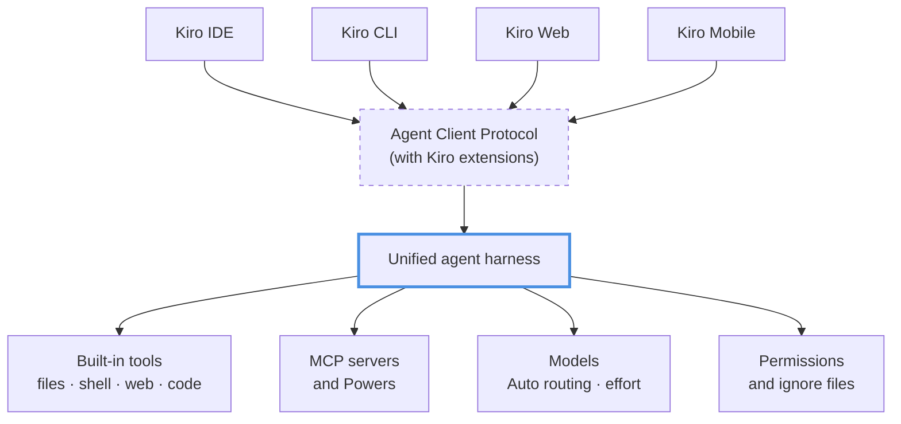

> ## Documentation Index
> Fetch the complete documentation index at: https://kiro.dev/llms.txt
> Use this file to discover all available pages before exploring further.

# How Kiro works

> One unified agent harness powers every Kiro surface. Learn how it connects the IDE, CLI, Web, and Mobile, and why your setup travels with you.

Kiro is one agent, available everywhere you work. Close your laptop and your session keeps running in the cloud. Check on it from your phone. Pick it up in the IDE the next morning. The IDE, CLI, Web, and Mobile apps are different ways to talk to the same **unified agent harness**, so when you configure a steering rule, write a custom agent, or connect an MCP server, you're configuring Kiro itself, not one particular app.

That one idea organizes everything else: capabilities live at the Kiro level and are documented once in **Features**, while each surface section covers only what that surface adds on top. This page walks through how the pieces fit together. For the engineering story behind the architecture, read [One agent, every surface](https://kiro.dev/blog/one-agent/) on the Kiro blog.

## One harness, many surfaces

At the center is the unified agent harness, which handles everything an agent run involves: orchestrating the conversation, executing tools, managing context, evaluating permissions, and talking to the LLM providers. Every Kiro surface (the IDE, CLI, Web, and Mobile) is a front end to that same harness.

The harness is a standalone process, not a library compiled into each app. It runs alongside your codebase, owns everything on the agent side, and the client owns how you interact with it. Because it's a separate process, the same harness can start on your laptop or inside a cloud sandbox, and it behaves identically in both.

Because the harness is shared, a capability behaves the same wherever it's available. A permission rule denies the same operations in the CLI as in the IDE. A steering file shapes the agent's behavior identically on every surface. Compaction preserves the same information. The surfaces differ in how you drive the agent, not in what the agent can do. Where a capability hasn't reached a surface yet, its feature page says so up front in an availability table.

### The boundary is a protocol

Clients talk to the harness through the open [Agent Client Protocol](https://kiro.dev/docs/acp.md) (ACP). That includes Kiro's own surfaces: the IDE, CLI, Web, and Mobile apps all speak ACP, extended with Kiro-specific methods (under the spec's `_kiro/` namespace) for features like live steering, spec workflows, rich permission prompts, and context usage tracking. Local clients connect over stdio; Web and Mobile connect to a sandboxed harness over WebSocket. Same binary, same tools, same behavior on either transport.

**ℹ️ Info:** Kiro isn't limited to its own surfaces. Because the boundary is standard ACP, compatible editors like JetBrains IDEs and Zed can use Kiro as their agent too. They connect the same way Kiro's own clients do.

## Anatomy of a turn

When you send a prompt from any surface, the harness runs the same loop:

1. **Context is assembled.** The harness gathers your prompt, the conversation so far, your [steering](https://kiro.dev/docs/steering.md) files, and anything you attached. [Prompt Submit hooks](https://kiro.dev/docs/hooks/types.md#prompt-submit) run here and can inject context of their own.
2. **The model plans.** The request goes to your selected [model](https://kiro.dev/docs/models.md), or Auto routes it to the best one for the task, and comes back with text, tool calls, or both.
3. **Every tool call is checked.** Before a tool runs, [permission rules](https://kiro.dev/docs/permissions.md) are evaluated (deny overrides ask, ask overrides allow), along with [kiroignore](https://kiro.dev/docs/kiroignore.md) patterns where they're enabled. [Pre Tool Use hooks](https://kiro.dev/docs/hooks/types.md#pre-tool-use) can gate or block the call.
4. **Tools execute.** [Built-in tools](https://kiro.dev/docs/tools.md) read and edit files, run shell commands, and search the web. [MCP servers](https://kiro.dev/docs/mcp.md) and [Powers](https://kiro.dev/docs/powers.md) extend the set, and [sub-agents](https://kiro.dev/docs/custom-agents/subagents.md) take on delegated work. [Post Tool Use hooks](https://kiro.dev/docs/hooks/types.md#post-tool-use) react to the results.
5. **Results feed back.** Tool output returns to the model, and the loop repeats until the task is done. [Agent Stop hooks](https://kiro.dev/docs/hooks/types.md#agent-stop) fire when the turn completes.
6. **Context stays managed.** As the conversation approaches the model's context limit, [compaction](https://kiro.dev/docs/compaction.md) summarizes older history so the session keeps going.

This loop is why the Features section is organized the way it is: each capability is a stage of the loop, not a bolt-on in one app. A permission rule you write once gates step 3 everywhere. A steering file shapes step 1 everywhere. That's the practical meaning of "one harness."

## What the harness owns

Each harness capability is documented once, at the Kiro level:

| Area | What it covers |
|------|----------------|
| [Specs](https://kiro.dev/docs/specs.md) | Structured development workflows: requirements, design, tasks |
| [Steering](https://kiro.dev/docs/steering.md) | Persistent project context and conventions |
| [Hooks](https://kiro.dev/docs/hooks.md) | Event-driven automation around the agent loop |
| [MCP](https://kiro.dev/docs/mcp.md) | External tool servers, OAuth, tool search |
| [Permissions](https://kiro.dev/docs/permissions.md) | Capability-based rules for what the agent may do |
| [Custom agents](https://kiro.dev/docs/custom-agents.md) | Agent profiles, built-in agents, sub-agent delegation |
| [Agent Skills](https://kiro.dev/docs/skills.md) | Portable instruction packages (open standard) |
| [Powers](https://kiro.dev/docs/powers.md) | MCP servers bundled with knowledge, loaded on demand |
| [Cloud sessions](https://kiro.dev/docs/cloud-sessions.md) | Run sessions in a managed cloud sandbox and attach from any surface |
| [Compaction](https://kiro.dev/docs/compaction.md) | Automatic context summarization for long sessions |
| [Kiroignore](https://kiro.dev/docs/kiroignore.md) | Keep files out of agent access with gitignore-style patterns |
| [Checkpoints and rewind](https://kiro.dev/docs/checkpoints.md) | Undo agent changes or fork a conversation at an earlier turn |
| [Built-in tools](https://kiro.dev/docs/tools.md) | The agent's file, shell, web, and code tools |
| [Models](https://kiro.dev/docs/models.md) | Model catalog, Auto routing, reasoning effort |

You'll find these under **Features** in the sidebar (Models has its own section). Not every capability has reached every surface yet, so each page opens with an availability table showing exactly where it works today. The direction is one harness, everywhere.

## Where the agent runs

The loop is the same everywhere, but the computer it runs on differs by surface:

- **IDE and CLI** run the harness on your machine by default. Tools operate on your local filesystem, shell commands run in your shell, and builds use your locally installed toolchain and credentials. You can turn on the [local command sandbox](https://kiro.dev/docs/sandbox.md) to run those shell commands inside an OS-level boundary that limits their network access. Both clients can also create and attach to [cloud sessions](https://kiro.dev/docs/cloud-sessions.md) that run in the same managed sandbox Web uses.
- **Web and Mobile** run the same harness in a managed [cloud sandbox](https://kiro.dev/docs/web/sandbox.md). Kiro clones your connected repository into an isolated environment, works there, and delivers changes back as pull requests or merge requests. Nothing executes on your machine, and sessions keep running after you close your laptop. Mobile picks up the same cloud sessions, so you can start work in the browser and check in from your phone.

A cloud session belongs to your account rather than to any one app, so you can start it on one surface and pick it up on another. See [Cloud sessions](https://kiro.dev/docs/cloud-sessions.md) for how each surface creates and attaches to them.

Same loop, same rules, same configuration format. The difference is where the work happens and how the results reach you.

## What each surface adds

The surface sections document the experience around the agent: how you invoke it, see its work, and stay in control. Surfaces aren't thin wrappers, either. A client can provide its own tools in place of the harness's built-ins where its platform does the job better; the IDE, for example, uses the editor's own APIs for file operations and adds editor-native code analysis on top.

| Surface | What it adds |
|---------|--------------|
| [IDE](https://kiro.dev/docs/ide.md) | Editor integration: inline diffs, checkpoints UI, spec panes, dockable chat, and sharing editor diagnostics with the agent through the #Problems context |
| [CLI](https://kiro.dev/docs/cli.md) | Terminal-native workflows: the TUI, headless mode for scripts and CI, autocomplete, session management from your shell |
| [Web](https://kiro.dev/docs/web.md) | Zero-setup agent in the browser: sandboxed execution, repository connections, pull-request-based delivery, automations on a schedule |
| [Mobile](https://kiro.dev/docs/mobile.md) | Kiro on the go: start and steer sessions from your phone |

If you're reading a surface section and find yourself asking "but how does the feature itself work?", the answer lives in Features, one level up.

## Your setup travels with you

Configuration follows the same shared model. What you define once applies wherever the harness runs:

| Scope | Location | Travels with |
|-------|----------|--------------|
| Project | `.kiro/` in your repository | The repo. Teammates and every surface that opens it get the same steering, specs, agents, hooks, and MCP servers |
| User | `~/.kiro/` on your machine | You. Personal agents, skills, steering, and settings across all local projects |
| Cloud | Your local `~/.kiro/` setup, synced to your account with [cloud configuration](https://kiro.dev/docs/web/cloud-configuration.md) | You. Personal steering, agents, hooks, skills, Powers, MCP servers, and workflows in every cloud session. Steering, agents, skills, Powers, and hooks can also apply to new local sessions |
| Workspace trust | `~/.kiro/workspace-roots/<hash>/` | Your machine only. Per-project permission rules stored outside the repo, so a cloned repository can never grant itself trust |

This is why Kiro Web and Mobile can pick up your project's agents and steering with no setup: they read the same `.kiro/` directory from your repository that the IDE and CLI use locally. See [Configuration scopes](https://kiro.dev/docs/configuration.md) for the complete reference.

## What this means in practice

- **Learn once, use everywhere.** The `permissions.yaml` you write for the CLI is the same file the IDE consults. A skill you add to your project works from every surface that opens it.
- **Consistent upgrades.** Harness improvements land in one place, and changes that don't touch the client protocol reach every surface with no app updates needed. Global hooks in `~/.kiro/hooks/` and improved compaction both shipped this way, arriving on all surfaces at once.
- **Team-wide consistency.** Committing `.kiro/` to your repository gives everyone the same agent behavior, whether they prefer the IDE, the terminal, or the browser.

## Next steps

- [Configuration scopes](https://kiro.dev/docs/configuration.md) for where every setting lives and how conflicts resolve
- [Custom agents](https://kiro.dev/docs/custom-agents.md) to shape the agent's tools, permissions, and prompt
- [Permissions](https://kiro.dev/docs/permissions.md) to control what the agent can do
- [Getting started](https://kiro.dev/docs/getting-started/installation.md) to install Kiro on your surface of choice
