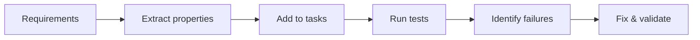

> ## Documentation Index
> Fetch the complete documentation index at: https://kiro.dev/llms.txt
> Use this file to discover all available pages before exploring further.

# Correctness with Property-based tests

> Ensuring specification quality through property-based testing and validation

| Capability | IDE | CLI | Web | Mobile |
|------------|:---:|:---:|:---:|:------:|
| Property-based testing | ✓ | — | — | — |

"Spec correctness" helps answer a fundamental question: does your implementation actually do what you specified? When AI generates code, how do you know it matches your intent?

## Concepts

Most tests today are *example-based*: each test sets up a concrete case with specific inputs and checks for one expected result. You write every case by hand, so your coverage is limited to the examples you (or the AI) happen to think of. Property-based testing (PBT) flips this around. Instead of listing examples, you state a general rule that must always hold, and the tool generates hundreds or thousands of random inputs to try to violate it.

You may see this same idea called *fuzzing* or *generative testing*. The terms are largely interchangeable - fuzzing grew out of security and crash-finding, while property-based testing emphasizes fine-grained logical correctness - but all three automatically generate many inputs and check that a property holds.

This is a step towards a fundamental shift in how we think about correctness with AI, moving from checking individual examples to validating universal properties across entire input spaces. Traditional unit tests only check specific examples, and whoever writes them - human or AI - is limited by their own biases. By automatically translating natural language specifications into executable properties and generating test cases from them, Kiro creates a feedback loop that helps both AI agents and human developers build more reliable software. This approach not only finds bugs that traditional testing misses, but also maintains a clear, traceable link between your requirements and the tests that validate them.

### What is a property?

A property is a universal statement about how your system should behave. Properties express the invariants and contracts that should always be true in your system, regardless of the specific data involved.

> For any set of inputs where certain preconditions hold, some expected behavior is true. 

In the Kiro specification world, this maps really well to our EARS requirements:

> "For any authenticated user and any active listing, the user can view that listing." This captures a general rule about system behavior that must hold across all valid scenarios.  

### How property-based testing works

Consider a car sales app:
- **Traditional test**: User adds Car #5 to favorites, Car #5 appears in their list
- **Property-based test**: For any user and any car, WHEN the user adds the car to favorites, THE System SHALL display it in their list

PBT automatically tests this with User A adding Car #1, User B adding Car #500, users with special characters in names, cars with various statuses, and hundreds more combinations - catching edge cases and verifying implementation matches intent.

Throughout this process, PBT probes to find counter-examples through **shrinking** - almost like a red team trying to break your code. When a random input triggers a failure, that input is often large and noisy (a 200-character username, a list of 1,000 cars). Shrinking automatically reduces it to the *smallest* input that still reproduces the failure - often a single empty string or a two-element list - so the root cause is obvious instead of buried. When it finds a violation, Kiro can automatically update your implementation or surface options to fix the spec, implementation, or test itself.

While not formal verification, PBT provides evidence for correctness across scenarios you'd never write manually - showing whether your implementation actually behaves according to what you defined.

### Strengths and limitations

Property-based testing saves time and increases confidence in AI-generated code because:

- One property generates many test cases automatically, so you aren't limited to the examples you or the AI thought to write by hand.
- Properties are higher-level and more enduring than specific examples, which makes the tests more maintainable and more resilient to changes in the implementation.
- Randomized inputs exercise cases you wouldn't test deliberately, including empty values, boundary conditions, and unusual characters.
- Exercising the system more thoroughly surfaces rare bugs before they reach production.
- Defining the properties a spec should guarantee, before any test runs, forces the requirement to be precise and easier to reason about.

Property-based testing also has limitations:

- It provides evidence of correctness, not a proof. It is not formal verification, so passing tests raise confidence but do not guarantee the absence of bugs.
- Identifying and defining useful properties takes work. A property that is too weak, or that states the wrong invariant, will pass while the real behavior is still wrong.
- Not every requirement maps cleanly to a property. Requirements that depend heavily on external services or non-deterministic behavior may need mocking, or may be better covered by example-based tests.

## Property-based testing w. Specs

Kiro integrates property-based testing throughout the spec workflow, from requirements to implementation validation.

### Workflow

Kiro extracts properties from your EARS-formatted requirements (e.g. "THE System SHALL allow authenticated users to view active car listings"), determines which can be logically tested, then generates hundreds or thousands of random test cases when you choose to run them.

### Design phase

In the design phase, Kiro extracts properties from your requirements and generates test cases. This is the first step in the workflow, where Kiro analyzes your requirements and identifies the properties that can be tested.

Hovering over a property reveals its connection to the original requirement and linked task.

### Executing tasks

In the execution phase, Kiro runs the generated PBT cases against your implementation. Note: PBTs are optional by default so you can focus on your core implementation first. Once a property test runs you can see the reference to the generated code.

When a property test fails, Kiro identifies the specific failure scenario and surfaces it for review. 

You can then chat with Kiro to understand the failure and determine the appropriate fix - whether that's updating the implementation, adjusting the test, or refining the requirement itself.

