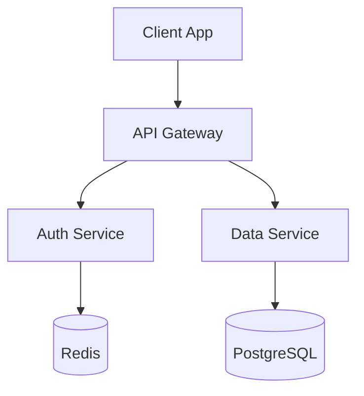
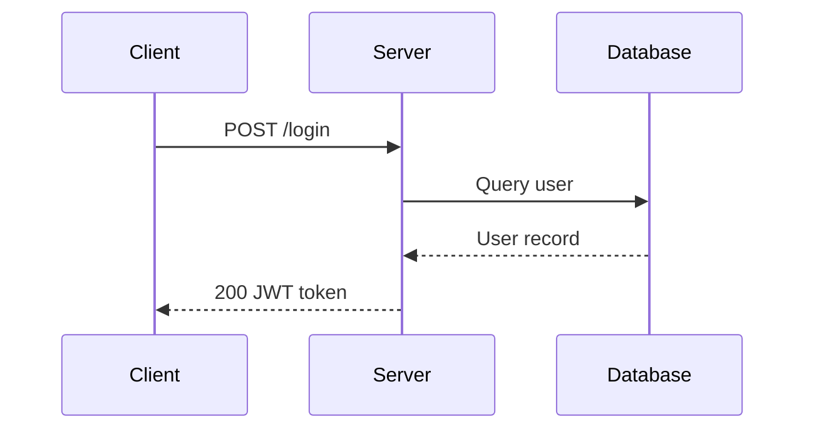
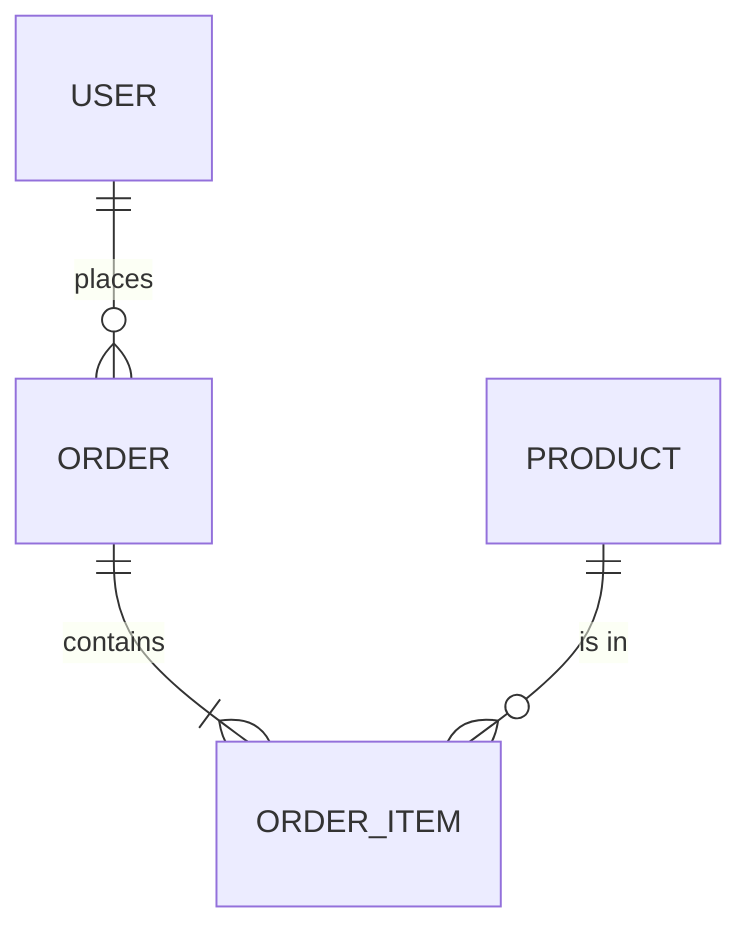
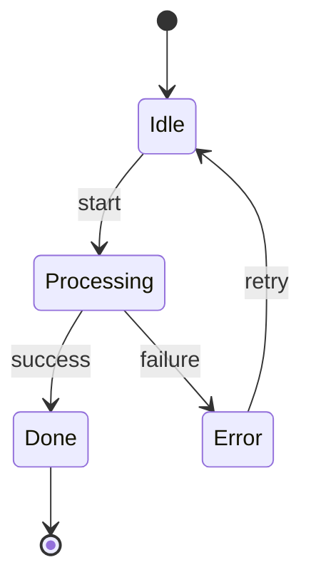
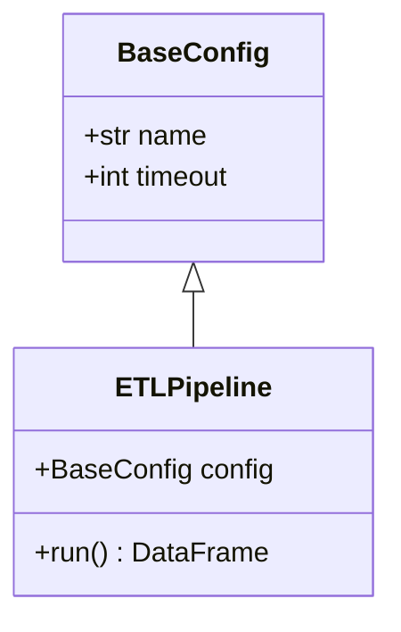

# Mermaid Worked Examples

One renderable example per diagram type. Load the entry for the type being written; the
syntax rules, the type-selection table and the per-type legends stay in `SKILL.md` and
apply to every example here.

Every example below satisfies the critical syntax rules: alphanumeric node IDs, plain
label text, spaces around arrows, no custom styling.

## Flowchart

## Sequence Diagram

## ER Diagram

## State Diagram

## Class Diagram

