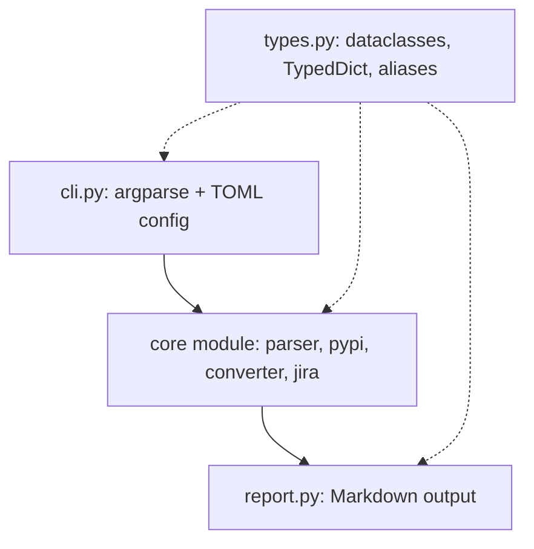

# Tools Reference

Maintainer notes for the tools under `tools/`: boundaries, pins, invariants and the
cross-tool build conventions. Read this when modifying a tool rather than invoking it;
for invocation decisions read `tools/TOOLS_OVERVIEW.md`.

Where each fact lives, so that it is stated once:

| Fact                        | Authority                                           |
| --------------------------- | --------------------------------------------------- |
| Behaviour, options, usage   | the tool's `README.md` and `--help`                 |
| Configuration keys          | `config.toml.example`                               |
| Module layout, test files   | the tool directory itself                           |
| Make targets                | `tools/tool.mk` (per tool) and the root `Makefile`  |
| Mirror scope (`docsync`)    | each mirror's `PROVENANCE.md` and `.last-sync.json` |
| Drift checks (`driftcheck`) | `CHECKS` in `driftcheck/registry.py`                |
| Dependency pins             | the tool's `pyproject.toml` and `uv.lock`           |

## Architecture pattern (shared by all tools)

Each tool is an independent uv project pinned to Python `==3.13.*`, with its
`pyproject.toml` as the single source of truth and the shared `tools/tool.mk` include
providing the `setup`, `clean`, `lint`, `code-check`, `test` and `all` targets.

## Build conventions

- The root `Makefile` lists the Python packages in `TOOLS` and derives `lint-<tool>`,
  `test-<tool>`, `lint-all` and `test-all` from it. The directory name must equal the
  module name, because `lint-<tool>` runs `mypy <module>` inside `tools/<tool>`.
- `lint-<tool>` runs the checking forms (`ruff check`, `ruff format --check`,
  `isort --check-only`, `mypy`, `complexipy`). The per-tool `lint` target fixes instead,
  so delegating the gate to it would let code pass by being rewritten.
- `test-<tool>` enforces an 80% coverage floor, set once in `tool.mk`.
- `make all` runs `fmt-check`, `drift-check`, `lint-all`, `test-all` and `hook-test`.
- Tools share no Python imported at runtime, so each stays independently installable and
  runnable via `uv run --project tools/<tool>`, and tools can be assigned to parallel
  agents without file overlap. Build tooling is exempt: `tool.mk` is shared by every
  tool Makefile, at the accepted cost that a tool directory is not self-contained if
  copied out of the repository.

## Cross-tool conventions

- Each tool reads its own `[tool_name]` section of the TOML file named by
  `WORK_AGENTS_CONFIG`; CLI arguments always override it.
- Argparse defaults are `None` for arguments resolved in `main()` through the TOML
  fallback.
- A `main()` returns an `int` exit code, and a malformed config TOML yields exit 1 with
  a message rather than a traceback.
- Logging uses `%(levelname)s: %(message)s`, and messages end with `.`.

## Tool notes

### depschecker

- Two version sources: freshness from the `pyproject.toml` constraints, vulnerabilities
  from the `uv.lock` resolved versions, the only place transitive dependencies appear.
  Design rationale (two PyPI endpoints, no severity data) is in its README.
- `requests>=2.32,<3` is the only runtime dependency.

### jirafetcher

- Configuration comes from a JSON file first and the `[jirafetcher]` TOML section as a
  fallback; a `token` is required.
- Target modes `--self` and `--include-parent` are mutually exclusive; the default
  operates on subtasks.

### doc2md

- Pins `faster-whisper==1.2.1` and `markitdown[docx,outlook,pdf,pptx,xls,xlsx]==0.1.5`.
  The explicit extras replace `[all]`, so only the converters for those formats are
  installed; audio goes through faster-whisper, not MarkItDown.
- Documents convert in a `ProcessPoolExecutor`; audio runs sequentially.
- Input hardening: path traversal checks, symlink escape detection, blob size limits and
  `os.umask(0o077)`.

### driftcheck

- Repository maintenance, not a routing target: it validates this repository's own agent
  system.
- The check list is `CHECKS` in `registry.py`; the README table mirrors it and the
  registry wins on any disagreement.
- `ALLOWED_MODELS` and `MODEL_COST_LABELS` in `checks/agents.py` hold the approved model
  ids and the cost label `routing.md` must publish for each. `MODEL_COST_LABELS` matches
  by prefix in insertion order, so the exact id `claude-opus-5.5` (`high (2.0x)`) must
  precede the `claude-opus-` family entry (`high (2.2x)`).
- The `prompt_quality` recall claim stays sourced to the 5.0 and 4.8 prompting guides,
  because the 5.5 guides do not restate it.
- The one lifecycle hook, `driftcheck-hook-refs-freshness`, is a workspace hook in
  `.kiro/hooks/hooks.json` with trigger `SessionStart`, invoked through
  `uv run --project tools/driftcheck`. Hooks that fire on every file write were removed
  as redundant with `make drift-check`; the rationale is in the driftcheck README.

### docsync

- Repository maintenance, not a routing target. No dependencies: fetching uses `urllib`
  from the standard library.
- One engine and one `DocSource` adapter per mirror (`kiro`, `agentskills`,
  `anthropic`). Scope of each mirror is defined by its source module and recorded in the
  mirror's `PROVENANCE.md` and `.last-sync.json`; do not restate page lists or counts
  elsewhere.
- Sources that enumerate their upstream (`kiro`, `anthropic`) support `--prune`;
  `agentskills` reads a fixed catalogue, cannot recognise an orphan and refuses it.
  `agentskills` and `anthropic` treat any unmirrorable page as a failed run that
  suppresses the sync marker; `kiro` tolerates a gap.

### ctxbudget

- Repository maintenance, not a routing target. Pins `tiktoken==0.13.0` exactly.
- Approximate by construction (`tiktoken/o200k_base`, not Anthropic's tokenizer): deltas
  are trustworthy, absolute totals are not. The README states the full caveat; never
  quote a total as a share of the context window.
- `MODEL_WINDOWS` in `windows.py` maps model ids to context windows. The 5.x ids are the
  ones `kiro-cli chat --list-models` reports, since the vendored docs name those models
  by display name only. A model absent from the table makes `calibrate` demand
  `--window` rather than assume a default.
- `check` exits 1 until a budget is recorded with `check --write-budget`; none is
  committed, so `context-budget-check` stays outside `make all`.
- It measures quantities and driftcheck validates structure. Its glob resolution
  duplicates `driftcheck/checks/agents.py` deliberately, to keep the no-shared-runtime
  boundary, so the two can disagree about glob semantics.
